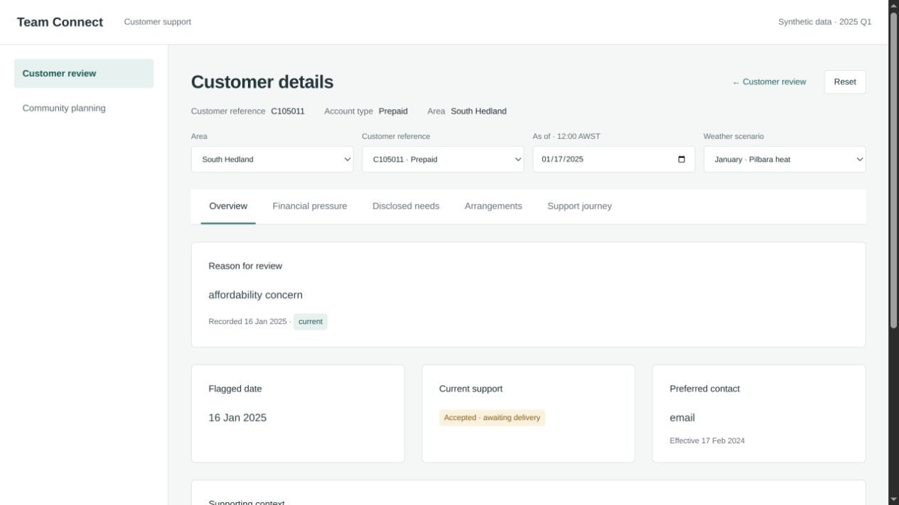
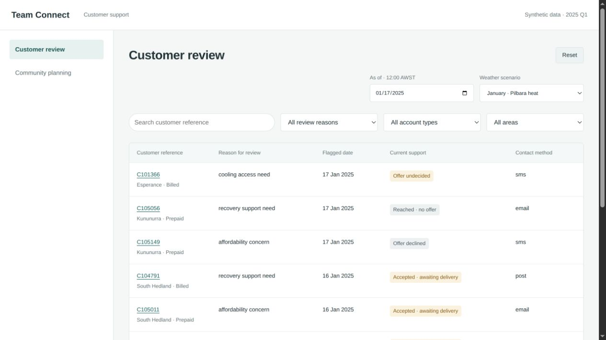
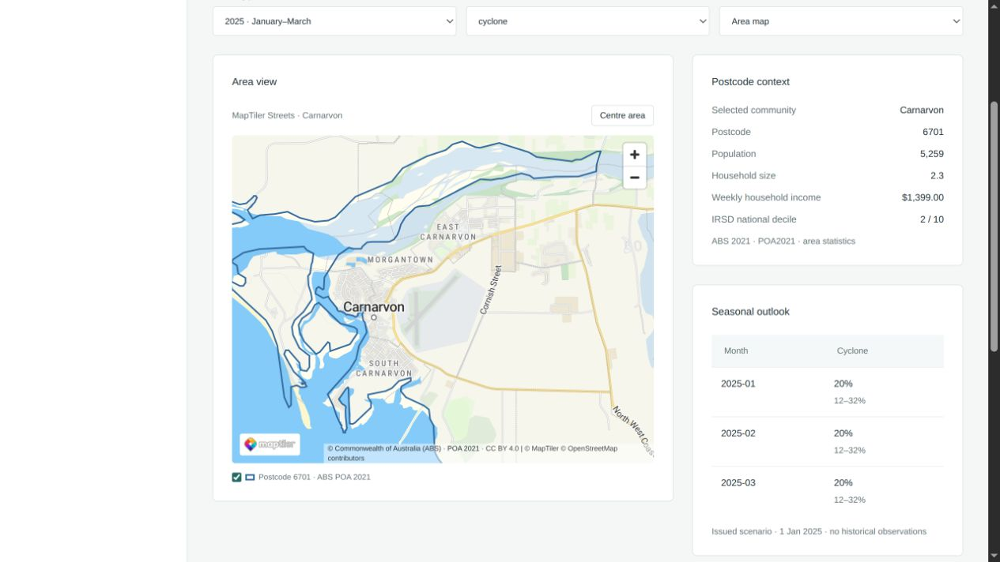

# Manny meeting and cloud-worker handoff · 27 October 2026

The latest local browser demo is preserved and prepared on **`meeting-manny-demo-2026-10-27`** in [Sploosh4/greenspark-hackathon](https://github.com/Sploosh4/greenspark-hackathon/tree/meeting-manny-demo-2026-10-27). Use the branch head shown by GitHub for the exact published revision. The older cloud UI has not replaced it. No branch merge, force push or deployment was performed.

## Starting state and preservation

- Actual local checkout: `~/Projects/greenspark-demo`, initially branch `demo`, commit `e3c95f2a4b0bed8a24d7c18f36b2808a48edadba`.
- Newer local seven-screen UI and MapTiler integration were uncommitted: README, third-party notices, verification notes, server, app, HTML and stylesheet; plus SAL boundary/source snapshots, the attribution logo and proxy tests.
- All 43 original non-ignored files were archived separately before editing, with a binary diff and state record. The archive excludes local environment files and is not published.
- `main`, `prototype` and the existing `demo` branch references were retained. The new meeting branch carries the intentional local implementation, placeholder removal and small workflow corrections.

## Meeting review

1. **Find a customer.** Customer review supports reference search, review-reason/account-type/area filters and pagination. At 17 January the local list now contains 99 accounts. Arrangement-only entries require a due/overdue review or another recorded trigger. C100562 and C104786 are excluded at that date; their account/support details remain accessible through the customer selector and direct URLs. Every distinct current disclosed reason is shown in the row; either disclosure filter matches any of them without hiding the others. Default sort is newest recorded date then reference. The existing reason cell and account panel now separate the dated review trigger from relevant support needs; missing triggers say Not recorded. Search `C105011` and select its reference. `C102046` demonstrates financial pressure and temperature management together and matches both disclosure filters.
2. **Review the account.** Overview, Financial pressure, Disclosed needs, Arrangements and Support journey share the same account/date. C105011 has $109.66 recorded prepaid credit on 17 January, with coverage withheld for insufficient on-supply observations. The billed example C105019 has $184.28 estimated charges against $167.89 (+9.8%). C101664 demonstrates an explicit cooling disclosure. C105011's check-in is active/delivered on 21 January; customer-confirmed resolution appears on 28 January.
3. **Return and plan.** Return to the list without changing its order, page or filter context. Community planning retains the real MapTiler basemap and the existing UI, now without a fictional square or customer dot. Pan/zoom, area selection and switching workspaces were checked.

Small corrections keep ordering stable after account selection, trim search whitespace, stop repeated active-tab clicks adding duplicate history, include overlapping support/disclosure records in the support filter, exclude ended arrangements from current-support summaries, and treat date-only review deadlines as overdue from the following day.

## Boundary handoff and real-data match

Reviewed [cloud boundary handoff](https://github.com/Sploosh4/greenspark-hackathon/blob/339a3ef731e83bf3e8927902b9cde97cf10513cc/docs/BOUNDARY_HANDOFF.md), branch `data/abs-poa2021-boundaries`, commit `339a3ef731e83bf3e8927902b9cde97cf10513cc`, based on `9792da1`.

The cloud environment's boundary download was blocked by a proxy 403. This local machine successfully fetched the handoff's exact official ABS query and reused its strict importer. All 12 requested postcode geometries match the unchanged scenario context. The prepared output SHA-256 is `cc048c3f7c2f1c88bb2b85b7d92a9e2553a610bac3374a070f7b9df1ded41f1c`.

- Current runtime layer: **ABS ASGS Edition 3, Postal Areas 2021 (POA_GEN / layer 1)**, EPSG:4326, CC BY 4.0.
- Runtime files: [`poa2021.geojson`](../teamconnect/geography/poa2021.geojson), [acquisition provenance](../teamconnect/geography/poa2021.provenance.json), and [strict join helper](../teamconnect/area-boundaries.mjs).
- Exact key: `context.POA_CODE_2021` (`POA6722`) → four-digit `poa_code_2021` (`6722`); `postcode`, geography `POA2021` and reference year `2021` must agree. No town-name, nearest-point or bounding-box join is used. The map omits an unavailable/ambiguous match.
- The postcode Census/SEIFA context is displayed at the matching POA2021 grain. For example, South Hedland selects postcode 6722, Carnarvon 6701. A whole postcode is not labelled as a town's extent.
- Community account/support aggregates remain community-based and are labelled separately. No statistics are allocated to individual customers or smaller polygons.
- Original SAL2021 locality snapshots remain preserved for reference, but are not drawn by the meeting map. The fictional forecast rectangle and customer point are not rendered. The unchanged scenario fixture still contains geometry needed for existing account/weather calculations.
- Importer, join helper and their tests were reused selectively from the boundary branch. No older cloud `app.mjs`, `core.mjs`, HTML, stylesheet or server was copied over the local implementation. Geometry structure, rings, code matches and hashes were validated; a formal topology audit is not claimed.

## Comparison with the other UI branch

`origin/fix/community-map-placeholders` is `9792da1b0a8092f0025dc4883403b48d837207ef`, one commit after the common `e3c95f2` base. It independently reconstructs the account UI and removes fictional map overlays, but its server/style have no working MapTiler connection. Six paths overlap with the preserved local work: `README.md`, `VERIFICATION.md`, `serve-demo.py`, `teamconnect/app.mjs`, `teamconnect/index.html`, `teamconnect/styles.css`. They require deliberate reconciliation; do not replace the current UI/server wholesale with that branch.

Remaining differences:

- The local table has tested default date/reference ordering but **no clickable column sorting**. The cloud UI branch has seven sortable columns, URL-persisted review state and a different 448-account list scope. These were not imported or redesigned for this meeting.
- Cloud-only financial input validation and contact/campaign-stage edge-case changes in `core.mjs` have not been merged. The local financial core and scenario/provenance are unchanged from `e3c95f2`; its 36 existing scenario checks pass. These parallel core changes still need review before combining branches.
- Dedicated mobile-device/non-Chrome testing and production suitability remain outside this meeting verification. The demo is a rough draft requiring further work.

## Local run and authorised configuration

```sh
python3 serve-demo.py --port 8787
```

Demo URL: **http://127.0.0.1:8787/**. Browser origin tested: **`http://127.0.0.1:8787`**. The local review server is running as the user service `teamconnect-demo-review.service`.

Configuration variable: **`MAPTILER_API_KEY`**. Existing file: **`~/Projects/team-connect/.env.local`**. Only that variable is read server-side. The loopback resource proxy keeps the value out of browser responses, URLs and logs; the environment file is neither served nor committed. The existing MapTiler key and allowed-origin settings were reused, with no credential/permission changes. The cloud worker must use its own already-authorised configuration if it needs live map access; no key is included in this branch. Ask the user before any credential or restriction change.

## Verification and screenshots

See [machine-readable browser results](qa/manny-2026-10-27/results.json). Verification includes the current customer workspace, real map, absence of placeholder sources, account/date progression and consistent canvas sizing after switching views. Offline checks are `node --test test-*.mjs`, `python3 test-map-proxy.py`, and `python3 test-poa2021-boundaries.py`. The unchanged release also reconciles 94 source hashes, 613,440 intervals and 12,780 balances/daily rows.






