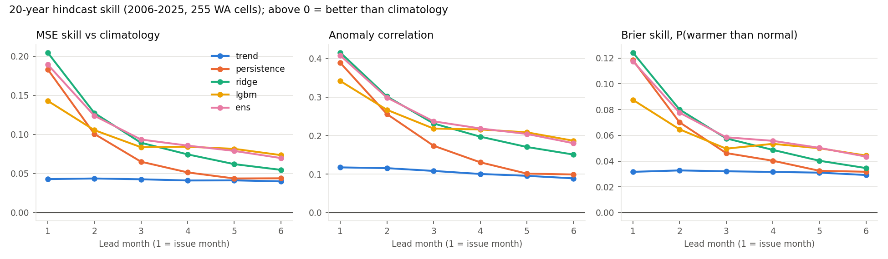
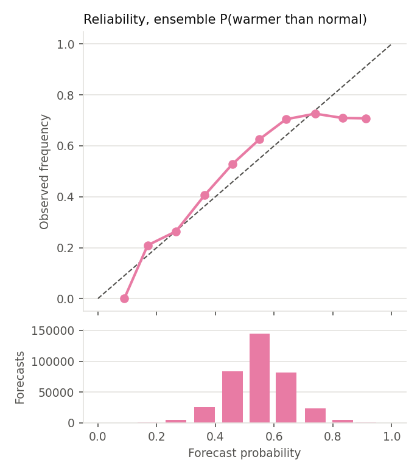
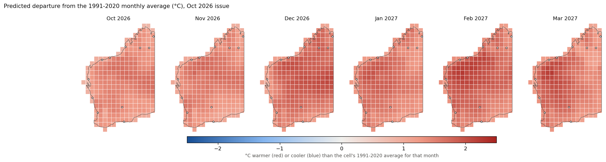
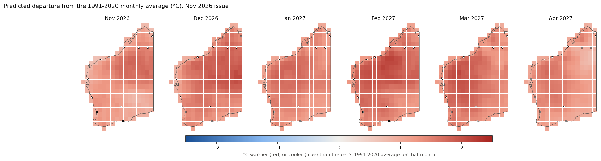

# ML seasonal temperature outlook for WA: study, build, test

29 October 2026 · prototype for the Long-term Natural Disaster Planner (Q3) · status: **experimental, for review**

## 1. Summary

- **What it predicts:** the monthly mean temperature map for the next six months on the same 1° WA grid as the
  "WA community outlook" screen, plus the chance that each month is warmer than its 1991–2020 average.
- **Model:** the average of a ridge regression and a LightGBM model. Both are trained on anomalies from each
  cell's normal and warming trend, with El Niño (Niño 3.4), SAM and recent temperature anomalies as predictors.
  A rolling bias correction and probability calibration are applied on top.
- **Tested** with a 20-year out-of-sample hindcast (2006–2025: 255 cells × 12 issues × 6 leads per year).
  It beats every simple baseline:
  - It reduces squared error against climatology by **23% at lead 1, falling to 10% at lead 6** (bias-corrected, 2011–2025).
  - It is statistically better than persistence at leads 2–5 and better than trend at every lead.
- **Current outlook:** both the October and November 2026 issues put **all of WA about +1.2 to +1.7 °C above
  the 1991–2020 average** for every month through March/April 2027. The calibrated chance of a warmer-than-normal
  month is **about 75–80% almost everywhere**.
  - Of that warmth, about +0.45 °C is long-term warming and +0.33 °C is recent faster warming.
  - About +0.7 °C comes from the current climate state: the strong 2026 El Niño (Niño 3.4 +2.8 °C) and a warm September.
- **Limits:** the skill is real but modest, which is normal for seasonal temperature. The model supports the
  "chance of warmer conditions" statement the Q3 document already allows. It does **not** support heatwave
  counts, event dates or customer-level conclusions.

## 2. What I studied

| Item | Finding | Consequence for the design |
|---|---|---|
| Q3 prototype document | Seasonal outlooks support "probability of warmer conditions", not event counts. Skill must be shown against hindcasts and an appropriate baseline. Do not imply more spatial precision than the data has. Keep historical, forecast and synthetic data separate. | Target = monthly mean temperature and P(warmer than normal) on the native 1° grid. Rolling-origin hindcast against climatology, trend and persistence. No interpolation below 1°. |
| Screenshot (WA community outlook) | C3S monthly mean, 1° native grid, fixed 14–36 °C scale, October 2026 issue covering Oct–Mar, Fitzroy Crossing cell 18–19°S, 125–126°E | Same grid and cell convention (`-18.5_125.5`), same scale, same lead convention (lead 1 = issue month). |
| Local repos and data | The outlook app, the SILO archive and the CDS download are **not on this machine**. The repos here are the Q1/customer demo and the earlier hackathon. | Built as a standalone module with a JSON output in grid form. Used free public data instead of SILO/CDS. |
| Public data reachable | NASA POWER (MERRA-2) monthly T2M to Sep 2026 and daily to 21 Oct 2026. CPC Niño 3.4 and SAM to Sep 2026. The IOD (DMI) series found only runs to May 2026. | 1981–2026 training data, no gaps across 255 cells × 552 months. IOD left out (see limits). |

## 3. Method

**Grid:** 255 one-degree cells touching WA, selected with the Natural Earth state outline.

**Target:** each cell's monthly mean 2 m temperature, expressed as an anomaly from a fold-local baseline.
The baseline is that cell's climatology for the calendar month plus its linear 1981-onward warming trend
(median +0.16 °C per decade).

**Issue convention (C3S):** an issue in month I uses data to the end of month I−1 and forecasts months I…I+5.

**Predictors:**
- lead and calendar month
- latitude, longitude, elevation
- the cell's anomalies for the last 1–3 months, 12 months and 10 years
- the neighbourhood (±2°) and WA-wide recent anomalies
- Niño 3.4 (level and 3-month change)
- SAM (1-month and 3-month)

**Models compared:** climatology, trend, damped persistence, ridge (one per lead), LightGBM, and the ridge +
LightGBM average.

**Hindcast:** for each year Y from 2006 to 2025, everything (baseline, models, spread) is fitted only on data
before 1 January Y, then all 12 issues of Y are forecast. LightGBM round counts and the spread (σ) come from an
inner validation on Y−5…Y−1. Partial months are never scored.

**Final forecast:**
1. Train on all data through Sep 2026.
2. Add the mean error of the last five hindcast years, per lead (+0.27 to +0.39 °C).
3. Convert to P(warmer than the 1991–2020 average) using the hindcast error spread
   (σ = 1.30 °C at lead 1, 1.38 °C at lead 6).
4. Calibrate those probabilities with an isotonic map fitted on the 2011–2025 hindcast.

**Tests (`test_seasonal.py`, 7/7 pass):**
- grid completeness and plausible ranges
- the cell-ID convention matches the screenshot
- the baseline ignores data after the cutoff
- poisoning every month at or after the issue leaves that issue's features unchanged
- lead 1 is the issue month
- the probability maths
- every hindcast row was issued in its own test year, with no duplicates

## 4. Results

**Skill against climatology, hindcast 2006–2025** (MSE skill: 0 = climatology, 1 = perfect)

| Lead | Trend | Persistence | Ridge | LightGBM | **Ensemble** | Ensemble + bias corr.* |
|---|---|---|---|---|---|---|
| 1 | 0.04 | 0.18 | 0.21 | 0.14 | **0.19** | 0.23 |
| 2 | 0.04 | 0.10 | 0.13 | 0.11 | **0.12** | 0.16 |
| 3 | 0.04 | 0.07 | 0.09 | 0.08 | **0.09** | 0.13 |
| 4 | 0.04 | 0.05 | 0.07 | 0.08 | **0.09** | 0.12 |
| 5 | 0.04 | 0.04 | 0.06 | 0.08 | **0.08** | 0.11 |
| 6 | 0.04 | 0.04 | 0.05 | 0.07 | **0.07** | 0.10 |

\*Scored on 2011–2025 so that each year has five prior years to correct from. On the same years, the
uncorrected ensemble scores 0.22, 0.14, 0.11, 0.11, 0.10 and 0.09.

**Anomaly correlation (ensemble):** 0.41 at lead 1, 0.24 at lead 3, 0.18 at lead 6.
**Brier skill for P(warmer than normal):** 0.12 at lead 1, 0.04 at lead 6.

**Is the gain real?** A year-block bootstrap (resampling whole years, 90% intervals) shows:
- **Ensemble vs persistence:** better at leads 2–5, with intervals above zero. Lead 1 is a tie and lead 6 is borderline.
- **Ensemble vs trend:** better at every lead.
- **Ensemble vs LightGBM alone:** better at leads 1–3 and equal at leads 4–6.

**Where it works:**
- **By region:** better in the north (Pilbara/Kimberley: 0.21 at lead 1, 0.08 at lead 6) than in the south (0.16 to 0.06).
- **By season:** best in summer (DJF 0.14) and weakest in winter (JJA 0.07).
- **By locality (all leads):** Broome 0.23, Perth 0.17, Port Hedland 0.16, Fitzroy Crossing 0.13,
  Kununurra 0.12, Kalgoorlie 0.11, Halls Creek 0.09. **No useful skill at Karratha (0.01) or Carnarvon (0.04).**

**Reliability:**
- From 0.25 to 0.75 the raw probabilities are close to observed frequencies, slightly low because warming outran the trend.
- Above 0.8 they were overconfident: forecasts of about 92% verified at 71%.
- The isotonic calibration fixes this, so displayed probabilities now level off at about 78–87%.

**What drives it:** LightGBM's largest gains come from Niño 3.4, the season, the Niño 3-month change, SAM and
WA-wide recent anomalies. Ridge leans on recent local and regional anomalies.

## 5. What did not work, and fixes made during testing

1. **Cold bias in recent years.** All models ran 0.25–0.34 °C too cold in 2016–25 because warming outpaced
   the 1981-onward linear trend.
   - A 10-year recent-anomaly feature **did not fix it** (bias 0.28 °C, skill unchanged).
   - A rolling five-year, per-lead bias correction **did**: bias fell to 0.09 °C and skill rose 1–1.5 points at every lead.
2. **Missing climate indices in the latest issue.** October's Niño 3.4 and SAM values are not published yet.
   Ridge filled the gap with 0, meaning "neutral ENSO" during a strong El Niño, and the November issue dropped
   by 0.8 °C. Fixed by carrying September's values forward (recorded in `forecast_grid.json` meta), plus a
   guard that refuses to forecast on any missing predictor.
3. **Overconfident high probabilities.** Fixed by the isotonic calibration (section 4).

## 6. Current outlook

| Locality (cell) | Nov 2026 | Dec 2026 | Jan 2027 | Feb 2027 | Mar 2027 |
|---|---|---|---|---|---|
| Fitzroy Crossing | 35.7 °C, +1.5 | 34.4, +1.8 | 32.3, +1.4 | 31.0, +1.6 | 30.1, +1.3 |
| Broome | 32.4, +1.1 | 32.2, +1.4 | 30.6, +1.4 | 29.8, +1.6 | 29.8, +1.3 |
| Port Hedland | 32.0, +1.2 | 33.5, +1.5 | 33.5, +1.5 | 33.0, +1.7 | 32.5, +1.6 |
| Kalgoorlie | 23.6, +1.2 | 26.9, +1.6 | 28.7, +1.4 | 27.8, +1.7 | 24.7, +1.7 |
| Perth | 21.0, +1.0 | 23.6, +1.1 | 25.4, +1.3 | 25.9, +1.4 | 24.6, +1.4 |

November 2026 issue. Values are the predicted monthly mean and the anomaly against 1991–2020.
The 80% range is about ±1.7 °C. P(warmer than normal) is 71–80%. The full grid for both issues is in
`outputs/forecast_grid.csv` and `outputs/forecast_grid.json`, and the full locality tables are in
`outputs/forecast_summary.txt`.

**Comparing with the screenshot:** the app shows Copernicus at 33.8 °C for Fitzroy Crossing in Nov 2026;
this model says 35.6 °C (October issue). The two use different reference datasets: MERRA-2's own 1991–2020
November normal for that cell is 34.2 °C. **Compare anomalies or probabilities, not absolute values, across products.**
Both point to a warmer-than-normal November.

## 7. Limits

- **Seasonal skill is modest.** At leads 3–6 the model removes only about 10% of climatology's squared error.
  Treat it as a planning nudge, as the Q3 document intends.
- **Monthly means are not heatwaves.** A warm month does not imply a heatwave count or timing, and a near-normal
  month does not rule one out.
- **The data are reanalysis, not station records.** MERRA-2 at about 50 km is smoothed against SILO station
  interpolation, and coastal cells mix land and sea air (likely why Karratha and Carnarvon show no skill).
  The model has not been checked against the SILO archive or BoM ACORN-SAT.
- **IOD is missing.** The Indian Ocean Dipole matters for south-west WA in winter–spring, and a current DMI
  series was not found in the time available.
- **Strong El Niño years are few in training** (1982, 1997, 2015, 2023). The current 2026 event (+2.8 °C in
  September) is near the top of the range, so the response to it is extrapolated from a small sample.
- **No comparison with Copernicus hindcasts yet.** This is the key open test: if C3S's own hindcast skill for
  WA is higher, use C3S and keep this model as a check or as a blend input.
- **The bias correction and calibration assume the recent five years represent the next year.**
- **The November issue uses October 1–21 and carried-forward indices.** Re-run once CPC publishes October
  (early November) and POWER completes the month.

## 8. Recommendation and next steps

1. **Use it as a second opinion beside Copernicus**, not a replacement. Display the anomaly or probability
   layer with its issue date, "experimental statistical outlook" wording and the skill table, as section 4 of
   the Q3 document requires.
2. **Score Copernicus the same way.** Download the C3S hindcasts (1993–2016) for these 255 cells and compare
   them against this model on the same years, then decide between C3S only, this model only, or a blend
   (blending usually wins).
3. **Add an IOD index**, from the BoM weekly OISST DMI or computed from OISST, and re-test the south-west in
   winter–spring.
4. **Validate at stations:** score against the 12 SILO locality series once that archive is on this machine.
5. **Refresh monthly:** run `fetch_data.py` → `run_backtest.py` (yearly is enough) → `run_forecast.py` after
   CPC and POWER publish, about the 5th–10th of each month.
6. **Discuss before any heatwave or event layer:** that is a separate modelling and validation task
   (daily data, event definition, hindcast), as the document says.
